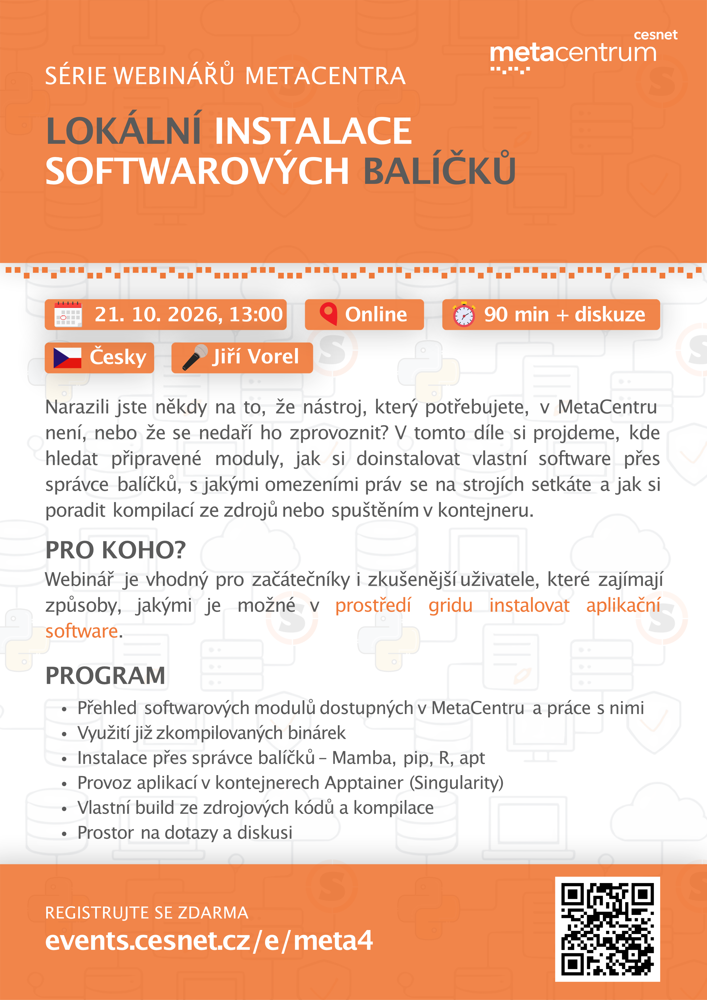

# **The MetaCentrum webinar series - SW installation**

This readme was created by Jiří Vorel (vorel@cesnet.cz).

The information provided in this webinar is current as of 21 October 2026.

The course is held online and is taught in Czech.

## Useful links
- [MetaCentrum](https://www.metacentrum.cz/cs/)
- [CESNET](https://www.cesnet.cz/)
- [e-INFRA CZ](https://www.e-infra.cz/)
- [e-INFRA CZ documentation](https://docs.e-infra.cz/)
- [Contact for MetaCentrum user support](https://docs.metacentrum.cz/en/docs/support)
- [MetaCentrum documentation](https://docs.metacentrum.cz/)
- [MetaCentrum monitoring page](https://my.metacentrum.cz/personal-view)
- [MetaCentrum hands-on courses](https://github.com/CESNET/metacentrum-hands-on)
- [MetaCentrum past seminars](https://metavo.metacentrum.cz/cs/seminars/)
